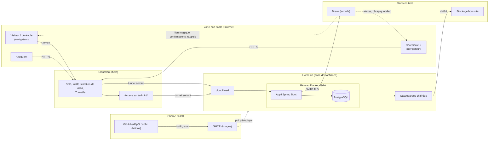

# Modèle de menaces — Hiver Solidaire

*Version 0.5 · 10 novembre 2026 (e-mails automatiques, S5a) · statut : à relire · méthode : STRIDE allégé*

Ce document répond à l'exigence du [cahier des charges](../cahier-des-charges.md) §8 (modèle de menaces documenté avant l'ouverture). Les probabilités et les impacts sont une première estimation (faible, moyen, élevé), à relire avant la bêta. Les mesures renvoient aux puces de la section « Sécurité » du §8.

## 1. Périmètre et hypothèses

- Appli Spring Boot sur un homelab, publiée par un tunnel Cloudflare sortant ; PostgreSQL sur un réseau Docker dédié ; e-mails par Brevo ; code et images sur GitHub et GHCR ([§9](../cahier-des-charges.md)).
- Une vingtaine de bénévoles majeurs, 2 à 3 coordinateurs. L'accès est libre à toute personne disposant du lien (§2), donc l'attaquant le plus probable est un inconnu sur Internet, pas un initié.
- Aucune donnée sur les personnes accueillies ; l'adresse du lieu n'est pas stockée (§6, lot 2).
- Hors périmètre : la sécurité des appareils des utilisateurs, celle de Cloudflare, de Brevo et de GitHub eux-mêmes, et un attaquant disposant d'un accès physique au homelab.

## 2. Flux et frontières de confiance

Frontières de confiance :

1. **Internet → Cloudflare** : tout contenu venant du navigateur est hostile (validation, CSRF, XSS).
2. **Cloudflare → homelab** : seul `cloudflared` parle à l'appli ; aucun port entrant ouvert.
3. **Appli → base** : seule l'appli parle à la base ; compte applicatif sans droits d'administration.
4. **Homelab → tiers** : Brevo reçoit les adresses des destinataires et le contenu des e-mails, dont le récap des coordinateurs (noms, pseudos et téléphones des inscrits des 7 jours suivants) ; le stockage hors site ne reçoit que des sauvegardes chiffrées.
5. **Chaîne CI → homelab** : le homelab tire des images, GitHub n'a aucune clé ni accès au homelab.

## 3. Actifs

| Id | Actif | Pourquoi il compte |
|---|---|---|
| A1 | Données des bénévoles (nom, prénom, e-mail, téléphone, inscriptions) | Données personnelles ; RGPD ; confiance des bénévoles |
| A2 | Sessions des coordinateurs | Donnent accès à tout, et à des actions d'administration |
| A3 | Disponibilité pendant la saison | Le planning organise une activité du soir au matin pour des personnes vulnérables |
| A4 | Réputation de l'association | Un incident ou un spam à son nom abîme la confiance |
| A5 | Secrets (Brevo, base, tunnel, sauvegardes) | Donnent accès aux actifs ci-dessus |
| A6 | Sauvegardes | Contiennent A1 ; condition de la reprise |
| A7 | Adresse et consignes du lieu (plus stockées par l'appli depuis le lot 2) | Sécurité des personnes accueillies |

## 4. Menaces

Catégories : **S** usurpation, **T** altération, **R** répudiation, **I** divulgation d'information, **D** déni de service, **E** élévation de privilèges. Statut : *prévu* (décidé dans le cahier des charges, à construire), *à décider*, *accepté*.

| Id | Menace | STRIDE | Actifs | Prob. | Impact | Mesure prévue | Statut |
|---|---|---|---|---|---|---|---|
| M1 | Lien magique intercepté (boîte mail compromise, e-mail transféré, historique) et rejoué | S | A1 | Faible | Moyen | Jeton à usage unique, 15 minutes, stocké haché et consommé atomiquement ; session avec nouvel identifiant à la connexion ; cookie `__Host-` HttpOnly, Secure (§8 « Lien magique », « Cookie ») | Fait (S3) |
| M2 | Lien consommé par le filtre d'une messagerie avant le bénévole (connexion impossible, ou connexion de la mauvaise session) | S, D | A1 | Élevée | Faible | Le lien ouvre une page de confirmation ; connexion en POST seulement, jamais de GET qui modifie (§6, §8) | Fait (S3) |
| M3 | Énumération d'adresses e-mail : réponse ou délai différent selon que l'adresse existe | I | A1 | Moyenne | Moyen | Même message et même durée de traitement dans les deux cas (envoi asynchrone, aucune recherche du compte à la demande) ; limitation par e-mail et par IP ; Turnstile (§8, S5) | Fait (S3), sauf Turnstile |
| M4 | Inscriptions malveillantes avec accès libre : robots qui saturent les places, créent des comptes, remplissent la base | D, T | A3, A4 | Moyenne | Moyen | Turnstile, limitation de débit Cloudflare et appli, alerte aux coordinateurs à la première inscription d'un nouveau bénévole, annulation par les coordinateurs (§2, §8) | Prévu |
| M5 | Abus de l'envoi d'e-mails : le formulaire sert à inonder une boîte tierce, ou épuise le quota de Brevo | D, R | A3, A4 | Moyenne | Moyen | Limitation par e-mail et par IP ; Turnstile ; e-mails automatiques bornés (S5a) : moins de 100 par jour estimés pour 300 permis, confirmations regroupées (un bénévole qui s'inscrit et se désinscrit en boucle reçoit un e-mail toutes les 10 minutes au plus), essais bornés à 6 par e-mail, un rappel et un récap par jour garantis par la base ; alerte si quota proche (**à décider** : seuil et supervision du quota) | En partie (S5a), supervision à décider |
| M6 | Compte coordinateur compromis (boîte mail hameçonnée, session volée, poste laissé ouvert) : lecture de toutes les coordonnées, exports, annulations et déplacements en masse, suppression de bénévoles, modification de la saison | S, E, I, T | A1, A2, A3, A7 | Faible | Élevé | Deux contrôles indépendants : Cloudflare Access sur `/admin/*` (code par e-mail ou fournisseur d'identité), puis le lien magique de l'appli ; rôle vérifié par l'appli sur chaque route (test sur toutes les routes du back-office) ; session de 8 h après la connexion ; aucun écran ne donne le rôle (liste dans la configuration du serveur, ADR-0010), donc un compte compromis ne crée pas d'autre coordinateur ; journal d'audit en ajout seul de chaque action et de chaque export ; aucune action ne touche une soirée passée ; une suppression de bénévole passe par une page de confirmation et l'anonymisation d'ADR-0008. Reste : retrait d'un coordinateur effectif à sa reconnexion (8 h au plus), sauf suppression manuelle de ses sessions (`deploy/README.md`) | Fait (S4b), sauf Access (configuration Cloudflare) |
| M7 | Contournement de Cloudflare Access en joignant l'appli sans passer par Cloudflare (tunnel mal configuré, autre route) | E | A1, A2 | Faible | Élevé | Aucun port entrant ; seul `cloudflared` joint l'appli ; le rôle coordinateur reste vérifié par l'appli, indépendamment d'Access (défense en profondeur) : l'appli ne lit aucun en-tête d'Access | Fait (S4b) côté appli |
| M8 | Un coordinateur nie une action (annulation, suppression de bénévole) | R | A1 | Faible | Faible | Journal d'audit (`audit_log`) horodaté par identifiant technique, écrit dans la transaction de l'action ; table en ajout seul (déclencheur qui refuse `UPDATE` et `DELETE`) ; pas de compte partagé (un coordinateur = une adresse). Le compte applicatif de la base peut toujours supprimer le déclencheur : le journal protège contre une erreur de l'appli, pas contre un accès direct à la base | Fait (S4b) |
| M9 | Accès croisé : un bénévole lit ou modifie les données d'un autre (IDOR), annule son inscription ou supprime son compte | I, E, T | A1 | Moyenne | Élevé | Autorisation côté serveur sur chaque endpoint ; le bénévole est celui de la session, jamais un paramètre ; l'inscription à annuler est cherchée parmi les siennes par la date de la soirée (aucun identifiant d'inscription dans l'URL, même réponse 404 qu'une soirée inconnue) ; tests d'accès croisé ; identifiants non devinables (§8) | Fait (S3, S4a) pour les bénévoles |
| M10 | CSRF : action déclenchée à l'insu d'un bénévole ou d'un coordinateur connecté (désinscription, suppression du compte, actions du back-office) | T | A1, A2 | Faible | Moyen | Protection CSRF active, POST pour toute action qui modifie l'état, page de confirmation avant chaque action ; les exports sont aussi des POST ; le sous-domaine est *same-site* du portfolio, donc le jeton reste obligatoire ([ADR-0001](../adr/0001-sous-domaine-plutot-que-sous-chemin.md)) | Fait (tests POST sans jeton, toutes les routes du back-office comprises) |
| M11 | XSS (contenu saisi affiché : pseudo sur la page publique, nom de bénévole, horaires et contact des coordinateurs dans le back-office et l'espace bénévole) | T, I | A2, A1 | Faible | Élevé | `th:text` uniquement, CSP stricte sans script inline, `frame-ancestors 'none'` (§8) ; cookie de session sur sa propre origine (ADR-0001) ; pseudo limité à lettres latines, chiffres, `-` et `_`, et `CHECK` en base refusant `< > & " '` ; nom et prénom limités aux lettres et à la ponctuation des noms ; textes de la saison bornés en longueur ; contact des coordinateurs limité à un numéro français ou une adresse sans caractère réservé de `mailto:` (lot 2) | Fait (S4b) |
| M12 | Injection SQL | T, I | A1 | Faible | Élevé | JPA et requêtes paramétrées seulement | Prévu |
| M13 | Données personnelles dans les logs, le journal d'audit, les sauvegardes non chiffrées ou les exports laissés traîner | I | A1 | Moyenne | Moyen | Aucun e-mail, téléphone ni nom dans les logs (testé sur les parcours du back-office) ni dans le journal d'audit (aucune colonne pour cela, testé) ; sauvegardes chiffrées ; exports CSV et page imprimable réservés aux coordinateurs, en POST audités, servis avec `Cache-Control: no-store` ; l'écran des exports rappelle de ne pas garder ni transférer les fichiers et de détruire les feuilles. **À décider** : consigne écrite aux coordinateurs sur la conservation des exports | Fait (S4b), consigne à décider |
| M14 | Vol ou perte de la clé de chiffrement des sauvegardes, ou sauvegardes inutilisables | D, I | A6, A3 | Faible | Élevé | Restauration testée avant l'ouverture ; clé conservée hors du homelab (**à décider** : où, et qui y a accès) | À décider |
| M15 | Homelab hors service en pleine saison (électricité, box, disque, panne de Cloudflare) | D | A3 | Moyenne | Élevé | Sonde externe toutes les 5 minutes, alerte téléphone ; RTO 4 h, RPO 24 h ; récap quotidien à 20 h (S5a, journées J+1 à J+7, lisible sans le site) et export PDF chez les coordinateurs ; ancien Google Form prêt ; runbook « site indisponible » (§8) | Prévu |
| M16 | Le plan B tombe avec le reste : le récap quotidien dépend du homelab et de Brevo | D | A3 | Moyenne | Moyen | Le récap de la veille au soir reste dans les boîtes des coordinateurs ; un récap manqué (appli arrêtée à 20 h) est rattrapé jusqu'au lendemain 8 h (ADR-0012) ; planning imprimable des 7 prochains jours (S4b), enregistré en PDF par un coordinateur et remis aux autres à l'avance, régulièrement (**à décider** : fréquence) | En partie (S5a), fréquence à décider |
| M17 | Compromission de la chaîne CI : action GitHub tierce piégée, dépendance Maven ou image de base malveillante, image GHCR remplacée | T, E | A1, A5 | Faible | Élevé | Dependabot et revue des dépendances, scan de l'image, pas de runner auto-hébergé sur un dépôt public, déploiement en pull sans clé du homelab dans GitHub, aucun secret dans le dépôt (§8). **À décider** : épingler les actions par empreinte et vérifier la signature de l'image | Prévu / à décider |
| M18 | Fuite de secrets (fichier d'environnement, dépôt public) | I, E | A5 | Faible | Élevé | Secrets hors du dépôt, dans un fichier sur le serveur, illisibles par Claude Code ; `.env.example` factice seulement | Prévu |
| M19 | Divulgation de l'adresse du lieu à des personnes non autorisées | I | A7 | Moyenne | Élevé | L'appli ne stocke plus l'adresse du lieu (lot 2) : elle n'apparaît ni sur la page publique, ni dans l'espace bénévole, ni dans les e-mails | Sans objet dans l'appli (lot 2) |
| M20 | Le prestataire d'e-mail ou Cloudflare lit ou perd des données | I, D | A1 | Faible | Moyen | Sous-traitants cités dans la notice ; e-mails sans donnée inutile (§7) : aucune adresse du lieu ni consigne, aucune adresse e-mail de bénévole dans le récap, aucun nom dans les alertes immédiates ; suivi des ouvertures et des clics désactivé chez Brevo (`deploy/README.md`) | Accepté (R3) |
| M21 | Repérage d'une personne par son pseudo public : savoir qu'elle sera à l'accueil tel soir, à telle heure (planning public, horaires connus), voire en déduire le lieu en la suivant | I | A1, A7 | Faible | Moyen | Pseudo choisi par le bénévole, qui peut éviter son prénom (aide du champ) ; aucune autre donnée publique ; pas de pseudo sur les journées passées (plus de soirée fermée depuis S4) ; `noindex` sur toutes les pages ; décision produit assumée (§2) | Accepté (R6) |
| M22 | Usurpation de pseudo : un inconnu prend « MarieD » avant Marie, ou un pseudo trompeur (homoglyphe, « Coordination ») pour s'inscrire au nom d'un autre | S | A3, A4 | Faible | Faible | Alphabet latin seul (pas de cyrillique ni de lettres pleine chasse), unicité sans tenir compte de la casse ; le bénévole change son pseudo dans « Mon compte » (S4a) ; alerte de première inscription aux coordinateurs (S5) ; modification par les coordinateurs (S4b) | Accepté en partie (R6) |
| M24 | Données d'un compte supprimé qui subsistent (ligne, liens de connexion, sessions encore valides sur un autre appareil) | I | A1 | Faible | Moyen | Anonymisation garantie par un `CHECK` en base ; suppression des liens en cours et de toutes les sessions du bénévole dans la même transaction ; test de vérification sur toutes les colonnes ([ADR-0008](../adr/0008-annulation-logique-et-anonymisation.md)). Les sauvegardes antérieures en gardent une copie jusqu'à leur expiration | Fait (S4a) ; durée des sauvegardes à décider (S6) |
| M25 | Désistements en masse : un compte compromis ou malveillant annule ses inscriptions, ou supprime son compte la veille, et vide des soirées | D | A3 | Faible | Moyen | Désinscription en autonomie seulement jusqu'à la veille 23 h 59 ; alerte « soirée devenue incomplète » enregistrée dans la même transaction, envoyée tout de suite par e-mail pour une soirée des 48 prochaines heures, dans le récap de 20 h sinon (S5a) ; la page de suppression demande de prévenir les coordinateurs pour une soirée imminente | Fait (S5a) |
| M26 | Injection de formule par l'export CSV : un nom ou un pseudo qui commence par `=`, `+`, `-` ou `@` s'exécute dans le tableur d'un coordinateur (lien piégé, exfiltration) | T, I | A1, A2 | Faible | Moyen | Toute cellule qui commence par `=`, `+`, `-`, `@`, une tabulation ou un retour chariot est préfixée d'une apostrophe ; cellules entre guillemets, guillemets doublés (test) ; en amont, nom, prénom et pseudo n'acceptent pas ces caractères en tête | Fait (S4b) |
| M27 | Bénévole sans e-mail créé par un coordinateur : compte utilisé pour se connecter à la place de quelqu'un, ou données saisies sans l'accord de la personne | S, I | A1 | Faible | Faible | Sans adresse, aucune connexion possible (la connexion cherche le compte par l'adresse du lien) ; mêmes règles de saisie qu'au premier profil ; création auditée ; la personne est informée par le coordinateur qui l'inscrit (**à décider** : mention dans la notice, S5) | Fait (S4b), notice à faire |
| M28 | Usurpation des e-mails de l'appli : un hameçonnage imite une confirmation ou un rappel (« désinscrivez-vous ici ») pour voler une session ou des données, ou l'en-tête « Répondre à » détourne les réponses | S, I | A1, A4 | Faible | Moyen | Domaine d'envoi authentifié chez Brevo (SPF, DKIM, DMARC, §9) ; expéditeur fixe « Hiver Solidaire » (`MAIL_FROM`) ; nos e-mails ne demandent jamais d'information ni de mot de passe, et leurs liens pointent vers `APP_BASE_URL`, en clair, sans réécriture ni suivi (test sur les quatre e-mails) ; le lien de désinscription ouvre une page de confirmation (GET sans effet) ; le lien de connexion n'est envoyé qu'à la demande ; « Répondre à » ne vient que du contact de la saison, validé (adresse sans caractère réservé) et saisi par un coordinateur ; sujets sans donnée saisie par un utilisateur (pas d'injection d'en-tête) | Fait (S5a), DMARC à vérifier au déploiement |
| M29 | Fuite des coordonnées par le récap : boîte d'un coordinateur compromise, récap transféré ou imprimé et laissé traîner, adresse de coordinateur mal saisie dans `APP_COORDINATOR_EMAILS` | I | A1 | Faible | Moyen | Contenu minimal : 7 jours, nom, pseudo et téléphone des inscrits, jamais leur adresse e-mail ; destinataires limités à `APP_COORDINATOR_EMAILS` (ADR-0010), sans copie ailleurs ; mention « ne le transférez pas, supprimez-le quand il ne sert plus » ; les alertes immédiates ne contiennent aucun nom ; journal technique sans adresse ni contenu (test). Reste : un récap par jour dans 2 à 3 boîtes, conservé selon leurs habitudes (**à décider** : consigne écrite aux coordinateurs, avec celle des exports, M13) | Fait (S5a), consigne à décider |
| M23 | Indexation par les moteurs de recherche : les pseudos et les soirées d'un bénévole deviennent trouvables hors de la communauté | I | A1 | Moyenne | Faible | `X-Robots-Tag: noindex, nofollow` sur toutes les réponses et `<meta name="robots">` ; aucun lien public attendu en dehors de la communauté | Fait |

## 5. Risques résiduels acceptés

| Id | Risque | Raison de l'acceptation | À réexaminer si |
|---|---|---|---|
| R1 | Boîte mail d'un bénévole compromise : l'attaquant se connecte comme lui (M1) | Un seul compte, peu de données (les siennes) ; pas de mot de passe plus sûr pour ce public | L'appli expose davantage de données aux bénévoles |
| R2 | ~~Tout inconnu qui s'inscrit voit l'adresse du lieu (M19)~~ Levé (lot 2) : l'appli ne stocke plus l'adresse | — | — |
| R3 | Dépendance à Cloudflare, Brevo et GitHub (M15, M20) | Pas d'alternative gratuite et simple ; plan B manuel | Panne longue pendant la saison |
| R4 | Disponibilité d'un homelab inférieure à celle d'un hébergeur ([ADR-0004](../adr/0004-homelab-et-cloudflare-tunnel-plutot-que-vps.md)) | Coût et apprentissage ; RTO de 4 h supportable avec le plan B | Bêta ou première moitié de saison en dessous de 99,5 % |
| R5 | Bénévole ou coordinateur malveillant dans un cercle de personnes qui se connaissent : un coordinateur voit et exporte toutes les coordonnées | Hors portée d'un MVP ; 2 à 3 coordinateurs désignés par le porteur du projet ; le journal d'audit dissuade et documente | Le nombre de coordinateurs ou de bénévoles augmente |
| R6 | Un pseudo public révèle qui vient tel soir à quiconque a le lien (M21, M22) | Décision produit (§2) : permettre de s'inscrire avec les gens qu'on connaît ; l'accès est libre, réserver le pseudo aux bénévoles connectés ne protégerait rien ; aucune autre donnée n'est publique et le bénévole choisit son pseudo | Incident de harcèlement, demande d'un bénévole, ou accès au site restreint à l'avenir |

## 6. Actions à suivre

| Quand | Action | Menaces |
|---|---|---|
| S3 | Tests d'accès croisé et de non-énumération ; comportement du lien magique avec un filtre de messagerie (fait : le GET du lien ne consomme pas le jeton) ; pseudo public : règles de forme, unicité, `noindex` (fait) | M2, M3, M9, M11, M21-M23 |
| S4 | Désinscription et « Mon compte » : tests d'accès croisé, CSRF, suppression sans reste (fait en S4a). Vérification du rôle côté appli sur toutes les routes du back-office, sessions de 8 h, journal d'audit, modification d'un pseudo par un coordinateur, export CSV neutralisé (fait en S4b). Reste : application Cloudflare Access à créer (`deploy/README.md`) | M6, M7, M8, M9, M10, M22, M24, M25, M26, M27 |
| S5 | E-mails automatiques par une table d'envois (fait en S5a : M25, M28, M29, une partie de M5 et M16) ; Turnstile, limitation par e-mail et IP, suivi du quota Brevo ; notice mentionnant le pseudo public et Brevo | M4, M5, M16, M21, M25, M28, M29 |
| S6 | Sauvegarde chiffrée, restauration testée, sonde externe, runbook ; épinglage des actions et signature de l'image | M14, M15, M17 |
| S8 | Plan B prêt (planning imprimable remis en PDF, Google Form), relecture du présent document | M15, M16 |
