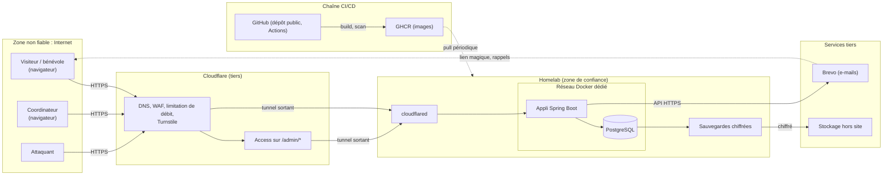

# Modèle de menaces — Hiver Solidaire

*Version 0.2 · 25 octobre 2026 (pseudo public) · statut : à relire · méthode : STRIDE allégé*

Ce document répond à l'exigence du [cahier des charges](../cahier-des-charges.md) §8 (modèle de menaces documenté avant l'ouverture). Les probabilités et les impacts sont une première estimation (faible, moyen, élevé), à relire avant la bêta. Les mesures renvoient aux puces de la section « Sécurité » du §8.

## 1. Périmètre et hypothèses

- Appli Spring Boot sur un homelab, publiée par un tunnel Cloudflare sortant ; PostgreSQL sur un réseau Docker dédié ; e-mails par Brevo ; code et images sur GitHub et GHCR ([§9](../cahier-des-charges.md)).
- Une vingtaine de bénévoles majeurs, 2 à 3 coordinateurs. L'accès est libre à toute personne disposant du lien (§2), donc l'attaquant le plus probable est un inconnu sur Internet, pas un initié.
- Aucune donnée sur les personnes accueillies ; l'adresse du lieu n'est pas publique (§6).
- Hors périmètre : la sécurité des appareils des utilisateurs, celle de Cloudflare, de Brevo et de GitHub eux-mêmes, et un attaquant disposant d'un accès physique au homelab.

## 2. Flux et frontières de confiance

Frontières de confiance :

1. **Internet → Cloudflare** : tout contenu venant du navigateur est hostile (validation, CSRF, XSS).
2. **Cloudflare → homelab** : seul `cloudflared` parle à l'appli ; aucun port entrant ouvert.
3. **Appli → base** : seule l'appli parle à la base ; compte applicatif sans droits d'administration.
4. **Homelab → tiers** : Brevo reçoit adresses et noms des destinataires ; le stockage hors site ne reçoit que des sauvegardes chiffrées.
5. **Chaîne CI → homelab** : le homelab tire des images, GitHub n'a aucune clé ni accès au homelab.

## 3. Actifs

| Id | Actif | Pourquoi il compte |
|---|---|---|
| A1 | Données des bénévoles (nom, prénom, e-mail, téléphone, inscriptions) | Données personnelles ; RGPD ; confiance des bénévoles |
| A2 | Sessions des coordinateurs | Donnent accès à tout, et à des actions d'administration |
| A3 | Disponibilité pendant la saison | Le planning organise une activité du soir au matin pour des personnes vulnérables |
| A4 | Réputation de l'association | Un incident ou un spam à son nom abîme la confiance |
| A5 | Secrets (Brevo, base, tunnel, sauvegardes) | Donnent accès aux actifs ci-dessus |
| A6 | Sauvegardes | Contiennent A1 ; condition de la reprise |
| A7 | Adresse et consignes du lieu | Sécurité des personnes accueillies |

## 4. Menaces

Catégories : **S** usurpation, **T** altération, **R** répudiation, **I** divulgation d'information, **D** déni de service, **E** élévation de privilèges. Statut : *prévu* (décidé dans le cahier des charges, à construire), *à décider*, *accepté*.

| Id | Menace | STRIDE | Actifs | Prob. | Impact | Mesure prévue | Statut |
|---|---|---|---|---|---|---|---|
| M1 | Lien magique intercepté (boîte mail compromise, e-mail transféré, historique) et rejoué | S | A1 | Faible | Moyen | Jeton à usage unique, 15 minutes, stocké haché et consommé atomiquement ; session avec nouvel identifiant à la connexion ; cookie `__Host-` HttpOnly, Secure (§8 « Lien magique », « Cookie ») | Fait (S3) |
| M2 | Lien consommé par le filtre d'une messagerie avant le bénévole (connexion impossible, ou connexion de la mauvaise session) | S, D | A1 | Élevée | Faible | Le lien ouvre une page de confirmation ; connexion en POST seulement, jamais de GET qui modifie (§6, §8) | Fait (S3) |
| M3 | Énumération d'adresses e-mail : réponse ou délai différent selon que l'adresse existe | I | A1 | Moyenne | Moyen | Même message et même durée de traitement dans les deux cas (envoi asynchrone, aucune recherche du compte à la demande) ; limitation par e-mail et par IP ; Turnstile (§8, S5) | Fait (S3), sauf Turnstile |
| M4 | Inscriptions malveillantes avec accès libre : robots qui saturent les places, créent des comptes, remplissent la base | D, T | A3, A4 | Moyenne | Moyen | Turnstile, limitation de débit Cloudflare et appli, alerte aux coordinateurs à la première inscription d'un nouveau bénévole, annulation par les coordinateurs (§2, §8) | Prévu |
| M5 | Abus de l'envoi d'e-mails : le formulaire sert à inonder une boîte tierce, ou épuise le quota de Brevo | D, R | A3, A4 | Moyenne | Moyen | Limitation par e-mail et par IP ; Turnstile ; alerte si quota proche (**à décider** : seuil et supervision du quota) | À décider |
| M6 | Compte coordinateur compromis (hameçonnage, session volée) : lecture de toutes les données, annulations | S, E, I | A1, A2 | Faible | Élevé | Cloudflare Access sur `/admin/*`, sessions de 8 h, rôle vérifié côté serveur, journal d'audit des actions (§8) | Prévu |
| M7 | Contournement de Cloudflare Access en joignant l'appli sans passer par Cloudflare (tunnel mal configuré, autre route) | E | A1, A2 | Faible | Élevé | Aucun port entrant ; seul `cloudflared` joint l'appli ; le rôle coordinateur reste vérifié par l'appli, indépendamment d'Access (défense en profondeur) | Prévu |
| M8 | Un coordinateur nie une action (annulation, suppression de bénévole) | R | A1 | Faible | Faible | Journal d'audit horodaté par identifiant technique ; pas de compte partagé | Prévu |
| M9 | Accès croisé : un bénévole lit ou modifie les données d'un autre (IDOR) | I, E | A1 | Moyenne | Élevé | Autorisation côté serveur sur chaque endpoint ; le bénévole est celui de la session, jamais un paramètre ; tests d'accès croisé ; identifiants non devinables (§8) | Fait (S3) pour les bénévoles |
| M10 | CSRF : action déclenchée à l'insu d'un bénévole ou d'un coordinateur connecté | T | A1, A2 | Faible | Moyen | Protection CSRF active, POST pour toute action qui modifie l'état ; le sous-domaine est *same-site* du portfolio, donc le jeton reste obligatoire ([ADR-0001](../adr/0001-sous-domaine-plutot-que-sous-chemin.md)) | Prévu |
| M11 | XSS (contenu saisi affiché : pseudo sur la page publique, nom de bénévole dans le back-office) | T, I | A2, A1 | Faible | Élevé | `th:text` uniquement, CSP stricte sans script inline, `frame-ancestors 'none'` (§8) ; cookie de session sur sa propre origine (ADR-0001) ; pseudo limité à lettres latines, chiffres, `-` et `_`, et `CHECK` en base refusant `< > & " '` | Prévu ; fait pour le pseudo |
| M12 | Injection SQL | T, I | A1 | Faible | Élevé | JPA et requêtes paramétrées seulement | Prévu |
| M13 | Données personnelles dans les logs, les sauvegardes non chiffrées ou les exports laissés traîner | I | A1 | Moyenne | Moyen | Aucun e-mail, téléphone ni nom dans les logs ; sauvegardes chiffrées ; exports PDF/CSV réservés aux coordinateurs (**à décider** : consigne sur la conservation des exports papier) | À décider |
| M14 | Vol ou perte de la clé de chiffrement des sauvegardes, ou sauvegardes inutilisables | D, I | A6, A3 | Faible | Élevé | Restauration testée avant l'ouverture ; clé conservée hors du homelab (**à décider** : où, et qui y a accès) | À décider |
| M15 | Homelab hors service en pleine saison (électricité, box, disque, panne de Cloudflare) | D | A3 | Moyenne | Élevé | Sonde externe toutes les 5 minutes, alerte téléphone ; RTO 4 h, RPO 24 h ; récap quotidien à 7 h et export PDF chez les coordinateurs ; ancien Google Form prêt ; runbook « site indisponible » (§8) | Prévu |
| M16 | Le plan B tombe avec le reste : le récap quotidien dépend du homelab et de Brevo | D | A3 | Moyenne | Moyen | Export PDF du planning remis aux coordinateurs à l'avance, régulièrement (**à décider** : fréquence) | À décider |
| M17 | Compromission de la chaîne CI : action GitHub tierce piégée, dépendance Maven ou image de base malveillante, image GHCR remplacée | T, E | A1, A5 | Faible | Élevé | Dependabot et revue des dépendances, scan de l'image, pas de runner auto-hébergé sur un dépôt public, déploiement en pull sans clé du homelab dans GitHub, aucun secret dans le dépôt (§8). **À décider** : épingler les actions par empreinte et vérifier la signature de l'image | Prévu / à décider |
| M18 | Fuite de secrets (fichier d'environnement, dépôt public) | I, E | A5 | Faible | Élevé | Secrets hors du dépôt, dans un fichier sur le serveur, illisibles par Claude Code ; `.env.example` factice seulement | Prévu |
| M19 | Divulgation de l'adresse du lieu à des personnes non autorisées | I | A7 | Moyenne | Élevé | Adresse absente de la page publique, présente seulement dans l'e-mail et l'espace bénévole (§6, hypothèse) ; accès libre par lien : tout inscrit la voit | Accepté en partie (R2) |
| M20 | Le prestataire d'e-mail ou Cloudflare lit ou perd des données | I, D | A1 | Faible | Moyen | Sous-traitants cités dans la notice ; e-mails sans donnée inutile (§7) | Accepté (R3) |
| M21 | Repérage d'une personne par son pseudo public : savoir qu'elle sera à l'accueil tel soir, à telle heure (planning public, horaires connus), voire en déduire le lieu en la suivant | I | A1, A7 | Faible | Moyen | Pseudo choisi par le bénévole, qui peut éviter son prénom (aide du champ) ; aucune autre donnée publique ; pas de pseudo sur les soirées fermées ni passées ; `noindex` sur toutes les pages ; décision produit assumée (§2) | Accepté (R6) |
| M22 | Usurpation de pseudo : un inconnu prend « MarieD » avant Marie, ou un pseudo trompeur (homoglyphe, « Coordination ») pour s'inscrire au nom d'un autre | S | A3, A4 | Faible | Faible | Alphabet latin seul (pas de cyrillique ni de lettres pleine chasse), unicité sans tenir compte de la casse ; alerte de première inscription aux coordinateurs (S5) ; modification par les coordinateurs (S4) | Accepté en partie (R6) |
| M23 | Indexation par les moteurs de recherche : les pseudos et les soirées d'un bénévole deviennent trouvables hors de la communauté | I | A1 | Moyenne | Faible | `X-Robots-Tag: noindex, nofollow` sur toutes les réponses et `<meta name="robots">` ; aucun lien public attendu en dehors de la communauté | Fait |

## 5. Risques résiduels acceptés

| Id | Risque | Raison de l'acceptation | À réexaminer si |
|---|---|---|---|
| R1 | Boîte mail d'un bénévole compromise : l'attaquant se connecte comme lui (M1) | Un seul compte, peu de données (les siennes) ; pas de mot de passe plus sûr pour ce public | L'appli expose davantage de données aux bénévoles |
| R2 | Tout inconnu qui s'inscrit voit l'adresse du lieu (M19) | Choix d'accès libre assumé (§2) ; garde-fous : Turnstile et alerte de première inscription | Incident, ou décision d'ajouter une validation préalable |
| R3 | Dépendance à Cloudflare, Brevo et GitHub (M15, M20) | Pas d'alternative gratuite et simple ; plan B manuel | Panne longue pendant la saison |
| R4 | Disponibilité d'un homelab inférieure à celle d'un hébergeur ([ADR-0004](../adr/0004-homelab-et-cloudflare-tunnel-plutot-que-vps.md)) | Coût et apprentissage ; RTO de 4 h supportable avec le plan B | Bêta ou première moitié de saison en dessous de 99,5 % |
| R5 | Bénévole ou coordinateur malveillant dans un cercle de personnes qui se connaissent | Hors portée d'un MVP ; le journal d'audit dissuade et documente | Le nombre de coordinateurs ou de bénévoles augmente |
| R6 | Un pseudo public révèle qui vient tel soir à quiconque a le lien (M21, M22) | Décision produit (§2) : permettre de s'inscrire avec les gens qu'on connaît ; l'accès est libre, réserver le pseudo aux bénévoles connectés ne protégerait rien ; aucune autre donnée n'est publique et le bénévole choisit son pseudo | Incident de harcèlement, demande d'un bénévole, ou accès au site restreint à l'avenir |

## 6. Actions à suivre

| Quand | Action | Menaces |
|---|---|---|
| S3 | Tests d'accès croisé et de non-énumération ; comportement du lien magique avec un filtre de messagerie (fait : le GET du lien ne consomme pas le jeton) ; pseudo public : règles de forme, unicité, `noindex` (fait) | M2, M3, M9, M11, M21-M23 |
| S4 | Cloudflare Access et vérification du rôle côté appli ; journal d'audit ; modification d'un pseudo par le bénévole ou un coordinateur | M6, M7, M8, M22 |
| S5 | Turnstile, limitation par e-mail et IP, suivi du quota Brevo ; notice mentionnant le pseudo public | M4, M5, M21 |
| S6 | Sauvegarde chiffrée, restauration testée, sonde externe, runbook ; épinglage des actions et signature de l'image | M14, M15, M17 |
| S8 | Plan B prêt (export PDF remis, Google Form), relecture du présent document | M15, M16 |
